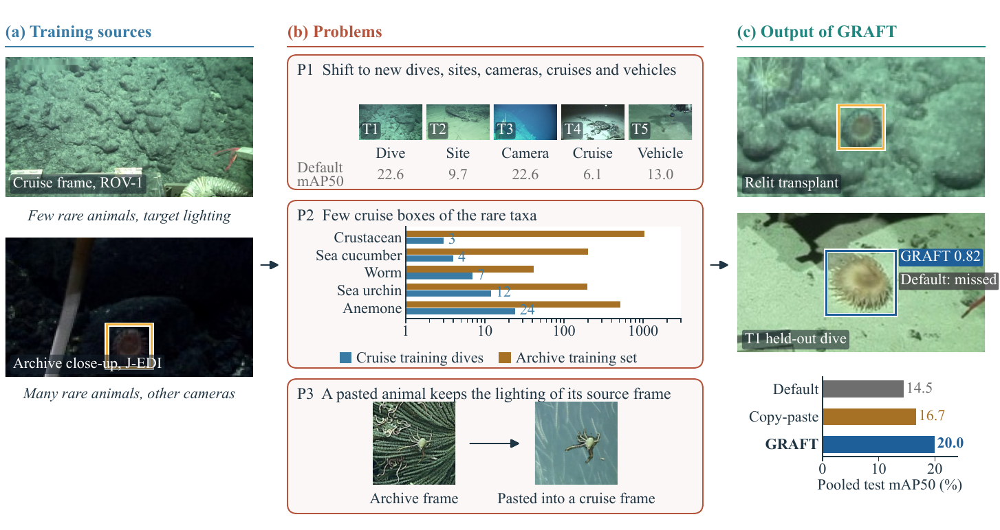
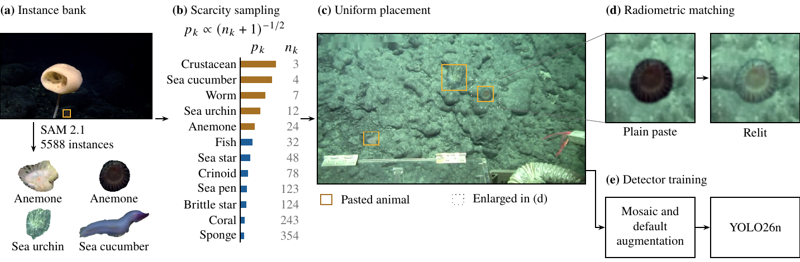
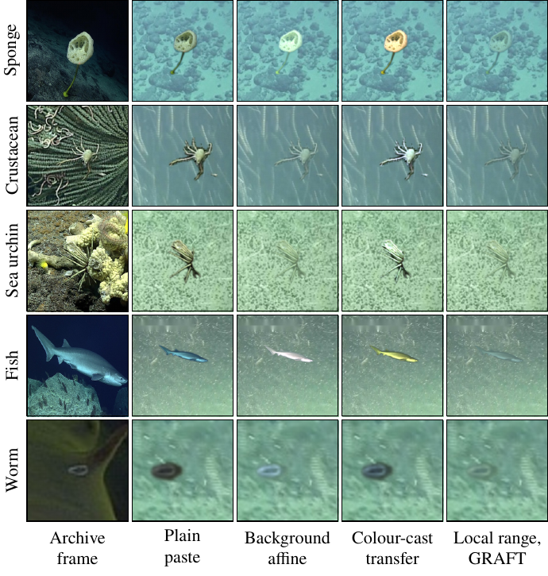
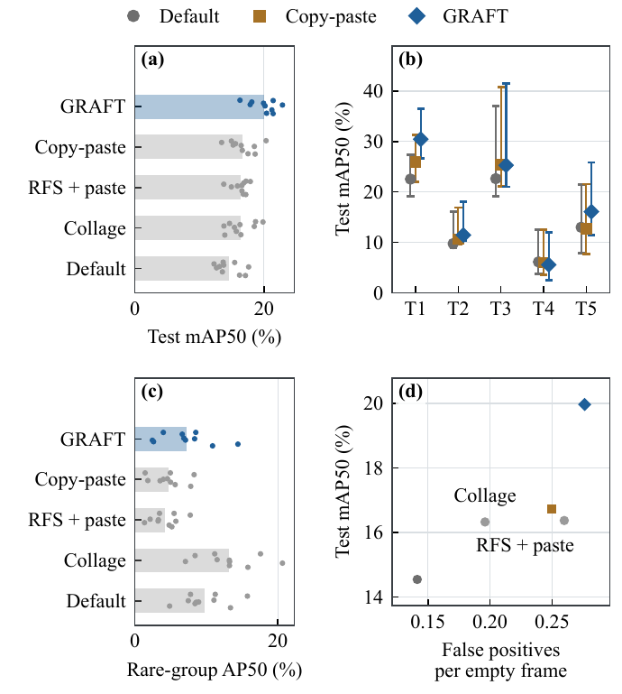

# GRAFT: Detection of Deep-Sea Benthic Megafauna Across Cruises Using Radiometry-Aware Transplantation of Archive Animals

Code, data lists, results and model weights for the paper

> **GRAFT: Detection of Deep-Sea Benthic Megafauna Across Cruises Using Radiometry-Aware Transplantation of Archive Animals**
> Jiaqing Wang†, Ruixuan Hu†, Jie Qin†, Hexiong Zhou\*, Zheng Zeng\*
> State Key Laboratory of Submarine Geoscience; Key Laboratory of Polar Ecosystem and Climate Change, Ministry of Education; Shanghai Key Laboratory of Polar Life and Environment Sciences; and School of Oceanography, Shanghai Jiao Tong University, Shanghai, China
> †Equal contribution &nbsp; \*Corresponding authors

**Project page:** https://panzerjagerwang.github.io/GRAFT/ &nbsp;·&nbsp; **Supplementary material:** [`docs/supplementary.pdf`](docs/supplementary.pdf) &nbsp;·&nbsp; **Weights:** [`weights/graft_yolo26n_seed0.pt`](weights/graft_yolo26n_seed0.pt)

## Abstract

Seafloor video from remotely operated and human-occupied vehicles records benthic megafauna for deep-sea biodiversity surveys. Detectors trained on some dives can lose much of their accuracy on new dives, sites, cameras, cruises, and vehicles. The rare taxa also provide few annotated animals. Image archives hold many close-ups of these taxa, but pasted animals keep the lighting of their source frames. We introduce Generalized Radiometry-Aware Fauna Transplantation, which inserts real archive animals into cruise training frames with the lighting of the seafloor at their new position. The method cuts archive animals with Segment Anything 2.1 and draws them by the scarcity of their taxon. Each pasted animal is mapped to the intensity range of the seafloor around it. The detector keeps the size and speed of YOLO26n. We also present a data set of 3689 annotated frames from three cruises, to be released, whose five test sets add a new dive, site, camera, cruise, or vehicle. Over ten seeds, the pooled mean average precision at an intersection over union of 0.5 rose from 14.5% with the default augmentation to 20.0%, versus 16.7% for plain copy-paste. With a quarter of the cruise training frames, the method reached 17.8%, above the default augmentation with all frames. It also raised four other one-stage detectors by 4.0 to 6.0 points. On the lowest-contrast quarter of the test frames, it reached 25.9%, against at most 19.1% for the others. Relit archive animals can thus extend the training data of compact detectors for deep-sea surveys across cruises.



*Fig. 1. Detection of deep-sea benthic megafauna across cruises. (a) Training sources: a cruise training frame and an archive close-up of an anemone. (b) Problems. P1: the five test sets, each adding one source of shift to the training dives, with the mAP50 of the default augmentation on each. P2: boxes of the rare taxa in the cruise training dives and in the archive training set on a logarithmic scale. P3: an archive crustacean in its source frame and pasted into a cruise frame with the lighting of that source frame. (c) Output of GRAFT. Top: the anemone of (a) relit and pasted into a cruise training frame. Middle: on a held-out dive, YOLO26n trained with GRAFT finds an anemone that the default training misses at a score of 0.25. Bottom: pooled test mAP50 over 10 seeds.*

## Method

GRAFT acts on one cruise training frame at a time before mosaic and leaves the detector and its inference unchanged.

* **Instance bank.** Every annotated animal of the archive training set and of the cruise training dives is cut with SAM 2.1, prompted with its box on the full-resolution frame. An instance enters the bank when the bounding box of its mask overlaps the annotated box with an intersection over union of at least 0.6, its largest connected part holds at least 70% of the mask, the mask covers at least 8% of the box, and the box does not touch the frame border and is at least 8 pixels on each side at the training scale. The bank holds 5797 instances, of which 4975 come from the archive and 822 from the cruise frames.
* **Scarcity sampling.** For each pasted animal GRAFT draws a taxon *k* with the probability of Eq. (3), where *n<sub>k</sub>* is the number of boxes of taxon *k* in the cruise training frames and α = 0.5, and then one bank instance of that taxon uniformly.
* **Placement and composition.** A cruise training frame receives pastes with probability 0.6, including the 1164 of the 1785 cruise training frames that contain no annotated animal. The number of animals is one plus a Poisson draw with mean one, capped at five. Each animal is placed at a uniform position with its annotated box height times a factor drawn uniformly from 0.5 to 1.5. A position is rejected when the box leaves the frame or overlaps an existing box by more than 30% of either box, and up to 30 positions are tried. The cut-out is composed with its mask, feathered by a Gaussian of 0.8 pixels.
* **Radiometric matching.** Each channel of the cut-out is normalized with the 5th and 95th percentiles of the animal pixels and scaled to the 5th and 95th percentiles of the target pixels in a ring around the pasted mask, Eq. (4). The strength λ is drawn uniformly from 0.5 to 1, the ring is as wide as 15% of the shorter side of the patch, and an instance range below four grey levels is raised to four. The mapping uses only the observed intensities around the paste location, so it needs neither a depth map nor calibrated lamps.

$$p_k = \frac{(n_k+1)^{-\alpha}}{\sum_{j} (n_j+1)^{-\alpha}} \tag{3}$$

$$\hat{I}_c = \lambda \left( q^{t}_{c,5} + \left(q^{t}_{c,95}-q^{t}_{c,5}\right) \frac{I_c - q^{i}_{c,5}}{q^{i}_{c,95}-q^{i}_{c,5}} \right) + (1-\lambda) I_c \tag{4}$$



*Fig. 3. GRAFT on one cruise training frame. (a) The archive frame of the anemone enlarged in (d) with its annotated box. Below it are four cut-outs of the instance bank, of which the first three are pasted in (c). (b) Probability p<sub>k</sub> of each taxon by Eq. (3) with the number n<sub>k</sub> of its boxes in the cruise training frames. Gold bars mark the rare taxa. (c) The augmented frame with the three pasted boxes and the square enlarged in (d). (d) The anemone of (a) in the dotted square of (c) pasted without and with the relighting of Eq. (4). (e) The augmented frame enters the default mosaic augmentation and the training of YOLO26n.*

<p align="center"></p>

*Fig. 4. Archive animals of five taxa pasted at the same position of cruise training frames. Columns: the animal in its archive frame, plain paste, a per-channel affine map of the background percentiles, a transfer of the colour cast, and the local-range mapping of GRAFT by Eq. (4). All mappings use the mean training strength λ = 0.75. Each crop is the frame region around the paste, enlarged three times.*

## Results

Test results of YOLO26n on the pooled test frames T1–T5 (1904 frames), mean ± standard deviation over 10 seeds. mAP50 and mAP50-95 average the seven main taxa with at least 20 test boxes; the rare group pools the five other named taxa into one precision-recall curve.

| Method | mAP50 | mAP50-95 | Rare-group AP50 | FP per empty frame |
|---|---|---|---|---|
| Default | 14.5 ± 1.9 | 7.2 ± 1.0 | 9.7 ± 3.2 | **0.14 ± 0.01** |
| RFS + paste | 16.4 ± 1.2 | 8.4 ± 0.8 | 4.2 ± 1.9 | 0.26 ± 0.04 |
| Collage | 16.3 ± 2.1 | 8.3 ± 1.3 | **13.2 ± 4.1** | 0.20 ± 0.02 |
| Copy-paste | 16.7 ± 2.1 | 8.4 ± 1.2 | 4.7 ± 2.2 | 0.25 ± 0.03 |
| **GRAFT** | **20.0 ± 2.0** | **10.2 ± 1.1** | 7.2 ± 3.7 | 0.28 ± 0.04 |

GRAFT raised the pooled test mAP50 of YOLO26n from 14.5 with the default augmentation to 20.0. Plain copy-paste had the highest mean score of the existing augmentations with 16.7. The planned comparisons of GRAFT with the default augmentation and with plain copy-paste were both significant at the 0.05 level after Holm correction. Over 1000 bootstrap resamples of the test images, shared by all runs, the gain over the default augmentation was 5.4 points with a 95% interval of 3.3 to 7.4, and the gain over plain copy-paste was 3.2 points with an interval of 1.6 to 4.9. On the rare group GRAFT scored 7.2 points against 13.2 for the context collage and 9.7 for the default augmentation, and it produced the most false positives on empty test frames, 0.28 per frame against 0.14 for the default augmentation. GRAFT scored highest on T1, T2 and T5; on the new dives of T1 it exceeded the best other method by 4.0 points and on the new vehicle of T5 by 3.1 points. On the auxiliary camera of T3 it scored 25.3 against 25.4 for plain copy-paste, and no method exceeded 6.1 points on cruise B of T4. On the quarter of the test frames with the lowest contrast GRAFT reached 25.9 against at most 19.1 for the other augmentations. In the cross-validation over the training dives, removing the relighting, the pasting into empty frames or the scarcity sampling lowered the score of GRAFT by 5.0, 4.0 and 3.8 points.

<p align="center"></p>

*Fig. 5. Test results of YOLO26n with 10 seeds per method. (a) Pooled test mAP50 with one dot per seed and the mean as a bar. (b) Rare-group AP50 with one dot per seed. (c) mAP50 on each test set with the 95% bootstrap interval of the mean over seeds. (d) False positives per empty test frame against the pooled test mAP50, as means over seeds. RFS denotes repeat-factor sampling.*

**Label budget.** With 25% of the cruise training frames GRAFT reached 17.8 points, above the 14.4 points of the default augmentation with all cruise training frames over the same five seeds. Pooled test results of YOLO26n over five seeds:

| Cruise frames | mAP50, Default | mAP50, GRAFT | Rare-group AP50, Default | Rare-group AP50, GRAFT |
|---|---|---|---|---|
| 10% (177) | 8.2 ± 1.0 | 12.6 ± 1.8 | 3.9 ± 1.3 | 4.8 ± 1.8 |
| 25% (446) | 11.4 ± 2.0 | 17.8 ± 1.4 | 6.5 ± 2.5 | 6.1 ± 1.5 |
| 50% (892) | 13.7 ± 1.5 | 18.5 ± 1.6 | 8.2 ± 3.0 | 8.2 ± 3.2 |
| 100% (1785) | 14.4 ± 1.9 | 20.1 ± 2.2 | 10.0 ± 2.3 | 7.5 ± 2.5 |

**Other detectors.** GRAFT raised the pooled test mAP50 of the four other detectors by 4.0 points with YOLOv8n to 6.0 points with YOLOv10n. Pooled test results over three seeds:

| Detector | mAP50, Default | mAP50, GRAFT | Rare-group AP50, Default | Rare-group AP50, GRAFT |
|---|---|---|---|---|
| YOLO26n | 14.9 ± 2.5 | 21.0 ± 0.7 | 8.4 ± 0.6 | 6.0 ± 1.7 |
| YOLO26s | 13.9 ± 0.2 | 19.3 ± 1.2 | 5.3 ± 2.1 | 7.4 ± 1.9 |
| YOLO11n | 15.0 ± 1.2 | 19.5 ± 1.5 | 6.5 ± 2.0 | 4.8 ± 1.7 |
| YOLOv8n | 14.9 ± 1.6 | 18.9 ± 0.5 | 6.7 ± 2.9 | 4.5 ± 2.5 |
| YOLOv10n | 14.0 ± 0.4 | 20.0 ± 0.5 | 6.0 ± 0.3 | 3.9 ± 1.8 |

The per-seed scores behind these tables are in [`results/`](results): `test_boot0.csv` (five methods, 10 seeds), `e4_boot0.csv` (label budget, five seeds) and `e5_boot0.csv` (other detectors, three seeds). Each row is one method and seed; the columns `<set>_<metric>` give mAP50, mAP50-95, rare-group AP50, class-agnostic AP50, false positives per empty frame and the AP50 of each taxon for the pooled test frames (`test`), each test set (`T1` to `T5`) and the archive test set (`oc`). Scores are fractions, and `train_min` is the training time in minutes. The method names are `B0_base` (Default), `B11_rfs_paste` (RFS + paste), `B10_context_collage` (Collage), `B3_naive_paste` (Copy-paste) and `GRAFT_s` (GRAFT); the suffixes `_p10`, `_p25`, `_p50` mark the label budget and `_yolo26s`, `_yolo11n`, `_yolov8n`, `_yolov10n` the detector.

## Data

**Cruise frames.** 3689 frames from the video of three cruises to seamounts and abyssal plains of the western Pacific Ocean, with 2493 annotated animals. The animals are labelled with 12 named taxa and an other-animal class, the 13 taxa of the detector, or as animals of unknown taxon, which are ignore regions in evaluation. Cruise A comprises 12 dives of a work-class ROV (ROV-1) at four seamount sites. Cruise B comprises one dive of the same vehicle on another seamount, recorded by one high-definition and six standard-definition cameras. Cruise C comprises two dives of an HOV (HOV-1), recorded by its pan-tilt and manipulator cameras. The frames were sampled from the video every 6 s and de-duplicated by perceptual hashing. The eight training dives of Cruise A (1785 frames) come from three seamount sites, and each test set adds one source of shift:

| Set | Frames from | New with respect to training | Frames |
|---|---|---|---|
| Training | Cruise A, eight dives at three sites, main camera | | 1785 |
| T1 | Cruise A, one held-out dive at each of the three sites, main camera | dive | 523 |
| T2 | Cruise A, the dive at a fourth site, main camera | site | 349 |
| T3 | Cruise A, T1 dives, auxiliary camera | camera | 223 |
| T4 | Cruise B, high-definition and standard-definition cameras | cruise, cameras | 406 |
| T5 | Cruise C, pan-tilt and manipulator cameras | vehicle, cruise | 403 |

**Archive set.** Close-up frames from the JAMSTEC E-library of Deep-sea Images (J-EDI, https://www.godac.jamstec.go.jp/jedi/), whose classes are mapped onto the same taxa (supplementary material, Section S1). The use of J-EDI images is subject to the J-EDI terms of use.

**Availability.** The cruise frames and their annotations will be released on the project page. Until then they are available from the corresponding authors on reasonable request.

This repository holds the split lists in [`data/lists`](data/lists), one frame name per line, and the main and rare taxa of the evaluation in [`data/eval_classes.json`](data/eval_classes.json). Cruise frames are named `<cruise>_<dive>_<camera>_<id>.jpg` and archive frames `S_<archive class>_<index>.jpg`.

| List | Frames | Content |
|---|---|---|
| `cruise_trainval` | 1785 | eight training dives of Cruise A, training set of all test runs |
| `cruise_train`, `cruise_val` | 1516, 269 | a split of `cruise_trainval`; `cruise_val` is only predicted |
| `cruise_trainval_p10`, `_p25`, `_p50` | 177, 446, 892 | nested subsets for the label budget, with the same share of every dive |
| `fold{0..3}_train`, `fold{0..3}_heldout` | | four cross-validation folds, each holding out two training dives |
| `test_T1` … `test_T5`, `test_cruise` | 523, 349, 223, 406, 403; 1904 | test sets and their union |
| `cond_dark`, `cond_lowcontrast`, `cond_blur` | 476 each | darkest quarter, quarter with the lowest RMS contrast and quarter with the lowest variance of the Laplacian of the pooled test frames |
| `oc_train`, `oc_val`, `oc_test` | 4050, 507, 505 | archive set |

## Repository layout

| Path | Content |
|---|---|
| `code/train.py` | training with one augmentation and prediction of the evaluation lists |
| `code/augment.py` | inserts an augmentation into the Ultralytics data pipeline before mosaic |
| `code/aug_methods.py` | GRAFT and the compared augmentations (copy-paste, context collage, photometric, habitat presets, AmpMix, LumiAug, marine snow, equipment distractors) |
| `code/build_bank.py`, `code/shrink_bank.py` | instance bank: SAM 2.1 cut-outs with quality rules, then a copy at the training scale |
| `code/evaluate.py` | COCO matching with ignore regions, mAP50, mAP50-95, rare-group and class-agnostic AP50, false positives per empty frame |
| `code/aggregate.py` | scores all finished runs and writes one csv row per method and seed |
| `code/aug_samples.py` | sample sheets of an augmentation |
| `data/` | split lists and evaluation classes |
| `results/` | per-seed test scores |
| `weights/` | YOLO26n trained with GRAFT, seed 0 |
| `docs/` | project page and supplementary material |

## Usage

**Environment.** Tested with Python 3.12, PyTorch 2.11 and Ultralytics 8.4.158 on one NVIDIA RTX 5070 (12 GB) or RTX 4070 Ti SUPER (16 GB); one training run of YOLO26n took 45 to 60 minutes.

```bash
git clone https://github.com/panzerjagerWang/GRAFT && cd GRAFT
pip install -r requirements.txt
```

**Data folder.** The scripts read a data folder (`--root`) with the following content. `lists/` and `eval_classes.json` are part of this repository, so the frames and labels can be added to `data/`:

```
data/
  lists/<list>.txt        frame names (this repository)
  eval_classes.json       main and rare taxa (this repository)
  images/<name>.jpg       frames resized to a long side of 640 pixels
  labels/<name>.txt       training boxes in YOLO format, classes 0-12 (an animal of unknown taxon is trained as otherbio)
  labels14/<name>.txt     evaluation boxes, class 13 for an animal of unknown taxon (ignore region)
  images.csv              one row per frame: name, source (cruise or oc), split (train, val, T1-T5, oc_*), dive, camera
```

The classes are `fish, seastar, brittlestar, urchin, cucumber, crinoid, coral, anemone, seapen, sponge, crustacean, worm, otherbio`. In the code the archive set is called `oc`.

**Instance bank.** SAM 2.1 is prompted with each box on the full-resolution frame (a folder with `images/<name>.jpg` at the original resolution); the cut-outs are then copied at the training scale:

```bash
python code/build_bank.py --mix data --fullres <full-resolution folder> --out bank_full --lists oc_train,cruise_trainval
python code/shrink_bank.py --src bank_full --dst bank
python code/aug_samples.py --root data --list cruise_trainval --aug graft --out sheet.jpg \
  --aug-args '{"bank":"bank","sampling":"scarcity","placement":"uniform","degrade":false,"max_tries":30,"p":0.6,"relight":"local_range"}'
```

**Training.** Every run starts from the COCO weights of the detector (downloaded by Ultralytics, or read from `--weights-dir`) and uses 640 pixels, batch 32, MuSGD with learning rate 0.01 and momentum 0.9, 100 epochs with mosaic closed in the last 10, the default augmentation of Ultralytics and the weights of the last epoch. GRAFT with the configuration of the paper:

```bash
for s in 0 1 2 3 4 5 6 7 8 9; do
  python code/train.py --root data --train cruise_trainval,oc_train --val oc_val \
    --predict test_cruise,oc_test,cruise_val --model yolo26n --epochs 100 --seed $s \
    --project runs/test --name t_GRAFT_s --aug graft \
    --aug-args '{"bank":"bank","sampling":"scarcity","placement":"uniform","degrade":false,"max_tries":30,"p":0.6,"relight":"local_range"}'
done
```

Each run writes `runs/test/<name>_s<seed>/` with the weights of the last epoch, `pred_<list>.json` for each predicted list and `done.json`; a run with a `done.json` is skipped. The compared methods use the same command with

| Method | `--name` | Augmentation arguments |
|---|---|---|
| Default | `t_B0_base` | `--aug base` |
| Copy-paste | `t_B3_naive_paste` | `--aug graft --aug-args '{"bank":"bank","sampling":"instance","placement":"uniform","relight":"none","degrade":false,"avoid_gear":false}'` |
| RFS + paste | `t_B11_rfs_paste` | as copy-paste, plus `--rfs 0.1` |
| Collage | `t_B10_context_collage` | `--aug graft --aug-args '{"bank":"bank","sampling":"scarcity","placement":"uniform","relight":"none","degrade":false,"mask":"rect","select":"context","avoid_gear":false}'` |

For the label budget replace `cruise_trainval` by `cruise_trainval_p25` (or `_p10`, `_p50`) and use seeds 0 to 4; for other detectors set `--model yolo26s`, `yolo11n`, `yolov8n` or `yolov10n` and use seeds 0 to 2. Cross-validation runs are named `cv_<method>_f<k>` and use `--train fold<k>_train,oc_train --val fold<k>_heldout --predict fold<k>_heldout`.

**Scoring.** `aggregate.py` scores all finished runs of a folder and writes the csv format of `results/`; `evaluate.py` scores one prediction file:

```bash
python code/aggregate.py --root data --runs runs/test --test --out results/my_test_boot0.csv
python code/aggregate.py --root data --runs runs/cv --out results/my_cv.csv
python code/evaluate.py --root data --pred runs/test/t_GRAFT_s_s0/pred_test_cruise.json --list test_cruise --by-split
```

**Weights.** `weights/graft_yolo26n_seed0.pt` is YOLO26n trained with GRAFT on the cruise training dives and the archive training set, seed 0, weights of the last epoch (pooled test mAP50 20.2):

```python
from ultralytics import YOLO
model = YOLO("weights/graft_yolo26n_seed0.pt")
model.predict("frame.jpg", imgsz=640, conf=0.25, save=True)
```

## Limitations

* The annotators who labelled the cruise frames also reviewed them, and the review covered 171 of the 1904 test frames. Two biologists checked the identifications.
* The rare group holds only 45 test boxes, which limits the precision of its average precision. On the rare group GRAFT scored below the default augmentation and the context collage.
* GRAFT produced more false positives on empty test frames than the default augmentation with each detector.
* The quality rules of the instance bank let some poor masks through, such as brittle stars cut out together with sediment.
* On the cameras of cruise B no augmentation scored above the default augmentation. GRAFT was tested only with one-stage YOLO detectors, and all test frames come from three cruises to the western Pacific Ocean.
* Relighting assumes that an animal spans a reflectance range similar to that of the seafloor around it. On a low-contrast seafloor the mapping can fade an animal almost into the background.

## License

The code is released under the GNU AGPL-3.0, because it builds on Ultralytics, which is released under the AGPL-3.0. The model weights are provided for research use.

## Citation

```bibtex
@article{wang2026graft,
  title  = {{GRAFT}: Detection of Deep-Sea Benthic Megafauna Across Cruises Using Radiometry-Aware Transplantation of Archive Animals},
  author = {Wang, Jiaqing and Hu, Ruixuan and Qin, Jie and Zhou, Hexiong and Zeng, Zheng},
  note   = {Manuscript},
  year   = {2026}
}
```

Contact: zhou_hexiong@sjtu.edu.cn, zheng.zeng@sjtu.edu.cn
